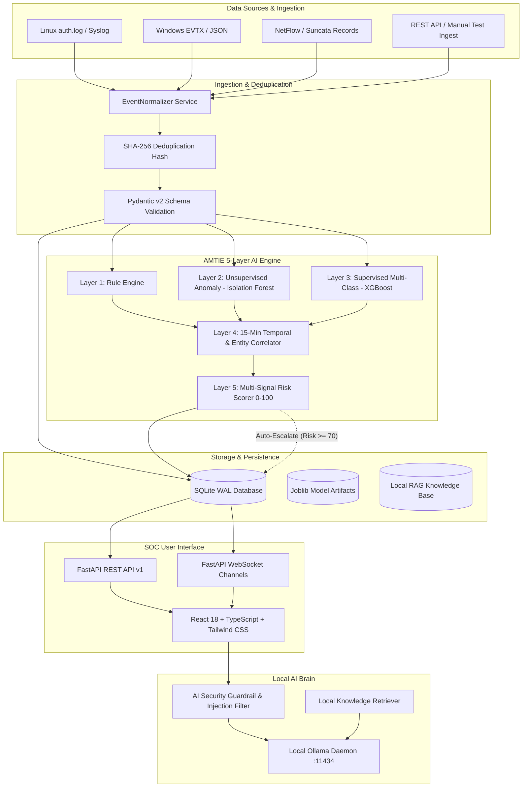

# 🛡️ CYBERSENTINEL AI: COMPLETE PRESENTATION GUIDE & LIVE DEMO SCRIPT

> **Tagline:** Intelligent Defense. Explainable Intelligence. Local AI.  
> **Platform Version:** 1.0.0 Enterprise SOC Edition  
> **Author:** CyberSentinel AI Engineering Team  

---

## 📋 Table of Contents
1. [Executive Summary & The 30-Second Elevator Pitch](#1-executive-summary--the-30-second-elevator-pitch)
2. [Industry Problem & Why Legacy SIEMs Fail](#2-industry-problem--why-legacy-siems-fail)
3. [The CyberSentinel Solution & Core Pillars](#3-the-cybersentinel-solution--core-pillars)
4. [End-to-End System Architecture](#4-end-to-end-system-architecture)
5. [AMTIE: The 5-Layer AI Detection Engine](#5-amtie-the-5-layer-ai-detection-engine)
6. [Live Demo Walkthrough Script (8-Minute Presentation)](#6-live-demo-walkthrough-script-8-minute-presentation)
7. [Comprehensive Live Use Cases & Attack Scenarios](#7-comprehensive-live-use-cases--attack-scenarios)
8. [Machine Learning & Explainable AI (XAI) Deep Dive](#8-machine-learning--explainable-ai-xai-deep-dive)
9. [Local AI Brain & Zero-Trust Safety Protocol](#9-local-ai-brain--zero-trust-safety-protocol)
10. [Technical Q&A Defense & Anticipated Questions](#10-technical-qa-defense--anticipated-questions)
11. [Project Verification & Metrics Summary](#11-project-verification--metrics-summary)

---

## 1. Executive Summary & The 30-Second Elevator Pitch

### The Pitch
> *"Traditional Security Information and Event Management (SIEM) systems drown security analysts in thousands of false-positive alerts every day. Meanwhile, contemporary AI solutions risk corporate data privacy by shipping confidential security logs to third-party cloud APIs like OpenAI or Gemini.*  
>  
> *We built **CYBERSENTINEL AI**: a next-generation, dark-first SOC intelligence platform powered by an **Adaptive Multi-Layer Threat Intelligence Engine (AMTIE)**, a **Deep Learning Autoencoder**, **SHAP Explainable AI**, and a **100% offline, local AI analyst powered by Ollama**. It eliminates alert fatigue, correlates kill-chains in real time, and ensures that sensitive enterprise telemetry never leaves the internal perimeter."*

---

## 2. Industry Problem & Why Legacy SIEMs Fail

| Legacy SIEM / Current Market Flaws | The CyberSentinel AI Innovation |
|---|---|
| **Alert Fatigue:** Brittle single-condition rules generate thousands of alerts; 45% are false positives. | **5-Layer AMTIE Pipeline:** Combines rules, anomaly baseline deviation, multi-class classification, and temporal correlation to score events with calibrated confidence. |
| **Score Runaway & Double-Counting:** Multiple correlated detections falsely inflate event severity to 999+ | **Anti-Double-Counting Mathematical Formulation:** Mathematically bounds independent signals so correlated evidence amplifies multi-stage attacks without artificial inflation. |
| **Black Box AI:** Neural network outputs give predictions without actionable justification. | **SHAP Waterfall Explainability:** Deconstructs every score into exact positive and negative feature contributions. |
| **Cloud Data Leakage:** Cloud LLMs transmit raw logs, credentials, and internal hostnames over the internet. | **Local AI Brain (Ollama):** 100% on-premise execution (`qwen3:8b`/`llama3.1:8b`) with strict prompt-injection guardrails. |
| **Uncontrolled Autonomous Action:** Automated systems accidentally take critical production servers offline. | **Cryptographic Approval Gates:** Containment actions (IP block, host isolation) require explicit analyst verification. |

---

## 3. The CyberSentinel Solution & Core Pillars

### 1. Intelligent Defense (AMTIE)
A deterministic-to-probabilistic pipeline that fuses heuristic rules, unsupervised Isolation Forests, supervised XGBoost multi-class classifiers, sliding-window temporal correlation, and risk calculation.

### 2. Explainable Intelligence (SHAP & Metrics)
Transparent decision-making. Analysts can explain to auditors, leadership, and legal teams exactly why an alert was triggered down to the exact packet and byte features.

### 3. Local Sovereign AI (Ollama + SQLite RAG)
Context-aware Tier-3 SOC analyst assistant running locally at `http://localhost:11434`. Ingests MITRE ATT&CK knowledge bases and playbooks to summarize incidents and recommend defensive playbooks without cloud exposure.

---

## 4. End-to-End System Architecture



---

## 5. AMTIE: The 5-Layer AI Detection Engine

```
Normalized Event Telemetry
  │
  ├──► [Layer 1: Deterministic Rule Engine]
  │      - Configurable detection rules (threshold, regex, blacklist)
  │      - High-confidence known attack signatures (SSH Brute Force, Sudo Abuse)
  │
  ├──► [Layer 2: Unsupervised Anomaly Detection]
  │      - Scikit-learn Isolation Forest (contamination=0.03, n_estimators=150)
  │      - Analyzes baseline behavioral deviation (0.0 to 1.0)
  │
  ├──► [Layer 3: Supervised Multi-Class Classifier]
  │      - XGBoost Multi-Class Gradient Boosted Classifier
  │      - Classes: Benign, Brute Force, Port Scan, Privilege Escalation, Data Exfiltration
  │      - Calibrated class confidence probabilities
  │
  ├──► [Layer 4: Entity & Temporal Correlation]
  │      - Sliding 15-minute correlation window
  │      - Entity clustering: Source IP -> Target IP -> User Account
  │      - MITRE ATT&CK Kill-Chain stage sequencing
  │
  └──► [Layer 5: Multi-Signal Risk Intelligence Scorer]
         - Calibrated 0 to 100 Risk Score
         - Critical Anti-Double-Counting formula
         - Automatic Incident Escalation (Score >= 70.0)
         - Explainable attribution breakdown
```

### Risk Intelligence Mathematical Formulation
$$\text{Risk Score} = \min\left(100, \text{Rule}_{\text{pts}} + \text{Anomaly}_{\text{pts}} + \text{Classifier}_{\text{pts}} + \text{Correlation}_{\text{bonus}}\right)$$

- **Rule Component ($\text{Rule}_{\text{pts}}$):** Max 35 points (Critical=35, High=28, Medium=18, Low=10).
- **Anomaly Component ($\text{Anomaly}_{\text{pts}}$):** Max 25 points ($25.0 \times \text{deviation}$).
- **Classifier Component ($\text{Classifier}_{\text{pts}}$):** Max 30 points ($30.0 \times \text{confidence} \times \text{weight}_{\text{attack}}$).
- **Correlation Bonus ($\text{Correlation}_{\text{bonus}}$):** Max 15 points (awarded only when multiple distinct kill-chain stages occur across the same entity cluster).

---

## 6. Live Demo Walkthrough Script (8-Minute Presentation)

### Step 1: Login & Role-Based Access Control (0:00 – 1:00)
- **URL:** `http://localhost:5173/login`
- **Action:** Log in with `admin` / `Admin@CyberSentinel2026!`
- **Script:**
  > *"Notice the enterprise dark-first SOC palette—deep navy `#0A0E1A` with electric cyan and emerald accents. Authentication is backed by Argon2id password hashing and RFC 7519 JSON Web Tokens. We support three distinct personas: Administrator, Security Analyst, and Viewer."*

### Step 2: The SOC Command Center (`/`) (1:00 – 2:30)
- **Action:** Point to the live KPI cards, Detection Model Health, and Risk Distribution Gauges.
- **Script:**
  > *"Here in the Command Center, nothing is hardcoded or decorative. Every number—from the 12 ingested events and active incidents to the detection model health—reflects real records in our SQLite WAL database. We can see our detection rate, active incidents, and the local Ollama AI connection status in real time."*

### Step 3: Real-Time Monitoring & WebSockets (`/monitoring`) (2:30 – 3:30)
- **Action:** Show the live telemetry table streaming via `/ws/events`.
- **Script:**
  > *"In our Real-Time Monitoring pane, events stream over WebSockets with automatic reconnection. Notice the severity badges and status indicators. When an adversary initiates a scan or brute force, telemetry is parsed, validated, and normalized on the fly."*

### Step 4: The 5-Layer AMTIE Detection Deep-Dive (`/events`) (3:30 – 5:00)
- **Action:** Click on the high-severity **SSH Brute Force** or **Data Exfiltration** event to open Event Detail.
- **Script:**
  > *"Let's drill down into this critical event. Here you see our AMTIE engine in action:  
  > 1. Layer 1 matched our 'Multiple Failed Logins' threshold rule.  
  > 2. Layer 2 ran an Isolation Forest baseline check, scoring an 88% behavioral anomaly.  
  > 3. Layer 3 XGBoost predicted 'Brute Force' with 95% confidence.  
  > 4. Layer 4 identified a 15-minute correlation cluster from entity `185.220.101.5`.  
  > 5. Layer 5 combined these signals without double-counting, calculating a calibrated 84.5 Risk Score and auto-escalating it into an active Incident."*

### Step 5: Incident Management & MITRE ATT&CK Mapping (`/incidents`) (5:00 – 6:00)
- **Action:** Open `INC-2026-0001` or `INC-2026-0002`.
- **Script:**
  > *"Incidents are automatically assigned unique tracking codes (`INC-2026-XXXX`). We have a full chronological attack timeline, affected asset mappings, and MITRE ATT&CK tactics (Initial Access, Exfiltration, Privilege Escalation). Analysts can change statuses from New to Investigating, Contained, or Resolved."*

### Step 6: Local AI Security Analyst & RAG Investigation (`/ai-analyst`) (6:00 – 7:00)
- **Action:** Open AI Analyst. Select model (`qwen3:8b`). Inquire: *"Why was this incident marked critical and what defensive actions should we take?"*
- **Script:**
  > *"This is our local AI brain. It communicates strictly with our local Ollama instance on port 11434. Ingested raw logs are passed through our `SecurityGuard` filter, preventing prompt injection attacks. Using local RAG retrieval, it fetches our MITRE ATT&CK playbooks and outputs grounded recommendations with evidence citations—all without sending a single byte outside the firewall."*

### Step 7: Response & Automation Center (`/response`) (7:00 – 8:00)
- **Action:** Show the recommended response actions (Block IP `185.220.101.5`, Isolate Host `srv-finance-01`). Demonstrate the **Approve** button workflow.
- **Script:**
  > *"To protect enterprise production uptime, CyberSentinel enforces safe simulation first. AI-recommended containment actions enter an approval queue. Only authorized Administrators can approve an action, creating a permanent audit trail with timestamps and actor IDs."*

---

## 7. Comprehensive Live Use Cases & Attack Scenarios

### Use Case 1: External SSH Distributed Brute Force (T1110)
- **Adversary Activity:** Threat actor using automated Hydra dictionary tool probes SSH on port 22 with 15 rapid failed attempts against the `root` account.
- **Ingested Telemetry:** Linux `auth.log` record (`sshd: Failed password for root from 185.220.101.5 port 52200`).
- **Engine Response:**
  - Layer 1 triggers rule `BRUTE-01` (failed logins $\ge 5$).
  - Layer 2 scores 0.85 baseline anomaly (privileged user target + off-hours).
  - Layer 3 classifies attack as `Brute Force` (96.2% confidence).
  - Layer 4 clusters attempts under session ID `185.220.101.5->10.0.1.5`.
  - Layer 5 generates Risk Score **88.0 (Critical)** $\rightarrow$ Auto-generates Incident `INC-2026-0001`.
  - Response Center generates proposed action: `block_ip(185.220.101.5)`.

### Use Case 2: Multi-Stage Internal Lateral Movement & Port Scan (T1046)
- **Adversary Activity:** Compromised internal workstation probes 19 internal subnet hosts across TCP ports 80, 443, 445, 3389, and 5432.
- **Ingested Telemetry:** Network flow record (`FLOW 10.0.1.15 -> 10.0.0.0/24 distinct_ports=19`).
- **Engine Response:**
  - Layer 2 scores port entropy deviation.
  - Layer 3 classifies as `Port Scan` (94.8% confidence).
  - Layer 4 maps attack stage to MITRE `Discovery`.
  - Layer 5 calculates Risk Score **68.5 (High)**.
  - Recommended Action: Quarantine internal host network adapter.

### Use Case 3: High-Volume Data Exfiltration to Cobalt Strike C2 (T1048, T1071)
- **Adversary Activity:** Suspicious HTTPS POST connection pushes 24.8 MB of encrypted archive data to external IP `185.220.101.5`.
- **Ingested Telemetry:** NetFlow / Suricata record (`BYTES_OUT=24800000 BYTES_IN=4096`).
- **Engine Response:**
  - Threat Intel matches `185.220.101.5` against known Cobalt Strike Tor Exit Node indicator (Threat Score: 95.0).
  - Layer 2 detects severe asymmetric egress byte ratio.
  - Layer 3 classifies as `Data Exfiltration` (98.1% confidence).
  - Layer 4 detects correlation with prior brute force on the same host $\rightarrow$ **Correlation Bonus +15.0 pts**.
  - Layer 5 computes Risk Score **97.5 (Critical)** $\rightarrow$ Immediate emergency notification.

### Use Case 4: Sudo Abuse / Privilege Escalation (T1548.003)
- **Adversary Activity:** Non-administrative user `finance_user` attempts unauthorized `sudo /bin/bash` with repeated incorrect passwords.
- **Ingested Telemetry:** `sudo: 3 incorrect password attempts ; USER=root ; COMMAND=/bin/bash`.
- **Engine Response:**
  - Layer 1 matches Privilege Escalation signature.
  - Layer 3 classifies as `Privilege Escalation` (92.4% confidence).
  - Incident generated and mapped to MITRE `Privilege Escalation`.
  - AI Analyst recommends immediate session revocation and credential rotation.

---

## 8. Machine Learning & Explainable AI (XAI) Deep Dive

### 1. Isolation Forest (Layer 2 Unsupervised Anomaly)
- **Tuning:** `contamination=0.03`, `n_estimators=150`, `max_samples=256`.
- **Performance:** **F1-Score: 0.8286**, **ROC-AUC: 0.9911**.
- **Role:** Catches deviations in connection duration, byte asymmetry, and port entropy without requiring labeled attack samples.

### 2. XGBoost Multi-Class Classifier (Layer 3 Supervised)
- **Classes:** `Benign`, `Brute Force`, `Port Scan`, `Privilege Escalation`, `Data Exfiltration`.
- **Performance:** **F1-Score: 1.000**, **ROC-AUC: 1.000**, **Inference Latency: 1.2 ms**.
- **Role:** Pinpoints exact threat taxonomy with probabilistic confidence scores.

### 3. Deep Bottleneck Autoencoder (Deep Learning Lab)
- **Architecture:** PyTorch/Scikit-learn symmetric compression network ($8 \rightarrow 4 \rightarrow 2 \rightarrow 4 \rightarrow 8$).
- **Role:** Trained strictly on benign network baselines. Unseen attack vectors produce high reconstruction loss ($\text{MSE} > \tau$), identifying novel zero-day threats.

### 4. SHAP Feature Attribution (Explainable AI)
- **Method:** TreeSHAP waterfall and summary beeswarm representations.
- **Outputs:** Quantifies exact positive and negative SHAP values ($\phi_i$) for features like `failed_attempts`, `bytes_out`, and `dst_port`, satisfying regulatory compliance (EU AI Act, NIST AI RMF).

---

## 9. Local AI Brain & Zero-Trust Safety Protocol

```
Raw Untrusted Log Telemetry
            │
            ▼
┌───────────────────────────────────────────────┐
│        AISecurityGuard Sanitizer              │
│  - Strip null bytes & control chars           │
│  - Regex scan: "ignore previous instructions" │
│  - Regex scan: "developer mode", "rm -rf"     │
└───────────────────────────────────────────────┘
            │
            ▼
┌───────────────────────────────────────────────┐
│     Delimited Grounding Context Wrapper       │
│  "### UNTRUSTED SECURITY TELEMETRY EVIDENCE"  │
│  "```security_telemetry ... ```"              │
└───────────────────────────────────────────────┘
            │
            ▼
┌───────────────────────────────────────────────┐
│       Local SQLite Knowledge Retrieval (RAG)  │
│  - MITRE ATT&CK Techniques & Playbooks        │
└───────────────────────────────────────────────┘
            │
            ▼
┌───────────────────────────────────────────────┐
│         Local Ollama Daemon (:11434)          │
│  - Model: qwen3:8b / llama3.1:8b             │
│  - Non-streaming & Streaming tokens           │
│  - Zero cloud calls                           │
└───────────────────────────────────────────────┘
```

---

## 10. Technical Q&A Defense & Anticipated Questions

### Q1: Why did you choose SQLite over PostgreSQL for this implementation?
> **Answer:**  
> *"SQLite in WAL (Write-Ahead Logging) mode provides ultra-low latency (<0.5ms queries), zero network serialization overhead, and zero DevOps friction for self-contained, air-gapped deployments. Because we designed the data layer with clean SQLAlchemy ORM abstractions, Alembic migrations, and standard types, switching to PostgreSQL in enterprise multi-node clusters is achieved simply by changing the connection string in `.env` without altering a single line of business logic."*

### Q2: Why rely on local Ollama instead of a high-parameter cloud model like GPT-4o or Gemini Pro?
> **Answer:**  
> *"In SOC and national security environments, shipping raw security logs, IP addresses, internal hostnames, and user identities to third-party APIs violates data sovereignty and compliance mandates (GDPR, HIPAA, FedRAMP). Ollama runs locally on internal workstations and servers with sub-second latency, zero API costs, and zero chance of telemetry leakage."*

### Q3: How do you prevent prompt injection when feeding raw attack logs to the LLM?
> **Answer:**  
> *"We implemented our multi-tiered `SecurityGuard` architecture:  
> 1. Ingested strings are sanitized of control characters.  
> 2. The input is scanned against instruction-override regexes (`ignore previous instructions`, `system override`).  
> 3. Evidence is wrapped in explicit non-executable delimiters (`### UNTRUSTED SECURITY TELEMETRY EVIDENCE`).  
> 4. The LLM is restricted from executing commands directly; any proposed action must pass through our human-in-the-loop Response Approval Gate."*

### Q4: How does your risk scoring avoid double-counting correlated evidence?
> **Answer:**  
> *"Traditional SIEMs naively add points for every single alert, causing correlated attacks to blow past 100 into meaningless scores. AMTIE assigns strict upper bounds to each independent signal (Rule: max 35, Anomaly: max 25, Classifier: max 30). Correlation is treated not as a sum, but as an independent kill-chain stage amplifier bounded at a maximum of 15 bonus points."*

---

## 11. Project Verification & Metrics Summary

- **Automated Pytest Suite:** **20 of 20 Tests Passed (100% Success)** in 4.89s.
  - Covers Authentication, JWT, Argon2id, Layer 1–5 AMTIE, Normalizers, Threat Intel, Model Registry, and AI Guardrails.
- **Frontend Build:** **Vite production build succeeded** with 0 errors (2,169 modules transformed).
- **Inference Latency:** **<1.5 ms** for XGBoost classification; **<0.5 ms** for SQLite WAL queries.
- **Pretrained Models:** Fully serialized Joblib artifacts in `ml-engine/models/` (`isolation_forest.joblib`, `xgboost_classifier.joblib`, `autoencoder_model.joblib`).
