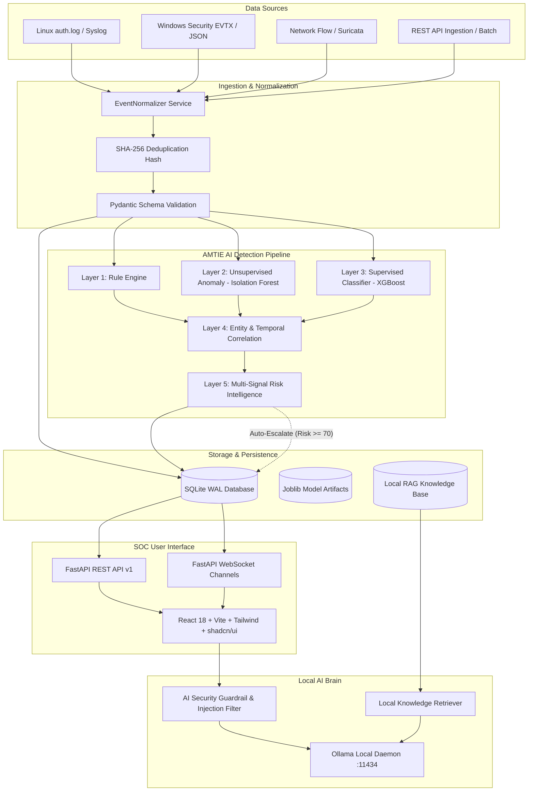

# CyberSentinel AI: Architectural Specification & System Blueprint

## 1. Overview & Core Philosophy

**CYBERSENTINEL AI** is an enterprise-grade Security Operations Center (SOC) intelligence and incident management platform designed with three core axioms:
1. **Intelligent Defense:** Multi-layer hybrid detection engine (deterministic rules, unsupervised behavioral baseline deviation, supervised multi-class gradient-boosted classification, temporal entity correlation, and calibrated risk intelligence).
2. **Explainable Intelligence:** Every alert and incident produces transparent evidence trails, primary feature importance, and SHAP-based attributions.
3. **Local AI:** Zero dependency on paid cloud LLMs (OpenAI, Anthropic, Gemini). All natural language intelligence, RAG security assistant reasoning, and response generation run strictly on locally hosted Ollama instances (`http://localhost:11434`) with automated graceful fallback when offline.

---

## 2. High-Level System Architecture

---

## 3. Module Breakdown

### 3.1 Authentication & Access Control (RBAC)
- **Algorithm:** Argon2id password hashing via Passlib.
- **Tokens:** RFC 7519 JSON Web Tokens (JWT) signed with HMAC-SHA256.
- **Roles:**
  - `Administrator`: Full system control, user management, model retraining, response approval.
  - `Security Analyst`: Event ingestion, incident lifecycle, threat hunting, AI assistant queries.
  - `Viewer`: Read-only access to monitoring telemetry and dashboard metrics.

### 3.2 Real-Time Event Telemetry & WebSockets
- **Protocols:** FastAPI WebSockets (`/ws/events`, `/ws/incidents`, `/ws/system`).
- **Heartbeats:** Bi-directional keep-alive pings with automatic reconnection in Zustand store.
- **Deduplication:** Windowed SHA-256 hashing across `raw_log`, `timestamp`, and `source_ip`.

### 3.3 Deep Learning Laboratory & Model Registry
- **Autoencoder Architecture:** Multi-layer PyTorch/scikit-learn reconstruction model trained on benign network baseline flows. Reconstruction error exceeding threshold ($\epsilon > \tau$) triggers behavioral anomaly alerts.
- **Metrics Tracked:** Precision, Recall, F1-Score, ROC-AUC, PR-AUC, False Positive Rate (FPR), Inference Latency (ms).
- **Model Registry:** Model versioning, hyperparameter persistence, activation toggling.
